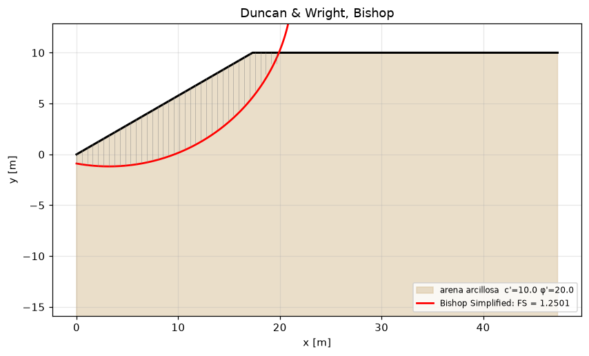

# slipcircle — slope stability by limit equilibrium (Fellenius, Bishop, Janbu, Spencer, Morgenstern-Price)

[Español](README.md) · **English** · [Português](README.pt.md) · [Italiano](README.it.md)

Factor of safety of slopes by the method of slices on circular and polyline surfaces, critical circle search, pore pressure (water table, piezometric line, r_u), pseudo-static analysis with the coefficients of EN 1998-5, permanent displacement by the Newmark sliding block and by Bray-Travasarou (2007), reinforcement with geosynthetics and soil nails, horizontal drains and minimum factors of safety by code. It depends on `numpy` and `scipy`; the methods are anchored to closed forms and to worked examples of the master's course.

[](https://github.com/jmurgass99/slipcircle/actions/workflows/ci.yml)
[](https://www.python.org/)
[](LICENSE)

## What problem it solves

You have a slope profile, its layers (c', φ', γ), perhaps a water table and a seismic action, and need the factor of safety of the most unfavourable failure surface with a method of slices whose result you can check. The package gives the five classical methods on the same discretisation, tells you whether the rigorous method has converged and lets you compare with the closed form when one exists.

**Use it when**

- you need the FS of a homogeneous or layered slope with Bishop or Fellenius and the critical circle by a sweep;
- you want to check against a rigorous method (Spencer, Morgenstern-Price) on a circle or a polyline, with the guarantee that `converged` tells the truth;
- you evaluate the slope with pore pressure from a water table, a piezometric line or r_u, or with a surcharge at the crest;
- you run the EN 1998-5 pseudo-static analysis and estimate the permanent displacement (Newmark with an accelerogram, Ambraseys-Menu, Bray-Travasarou);
- you add geogrids, geotextiles or soil nails and need their resisting moment, or size horizontal drains at concept stage.

**Don't use it for**

- effective stress analysis with flow nets or consolidation: pore pressure is given, not computed;
- 3D wedge failures, rock slopes (Hoek-Brown is not included) or dam stability with transient seepage;
- a full EC7 design with partial factors: characteristic values are compared with tabulated minima; you apply the factors on tan φ' and c' in the layers;
- seismic earth pressure on walls (Mononobe-Okabe K_AE): `mononobe` is a pseudo-static wedge for an infinite slope, not a wall.

## Installation

```bash
pip install git+https://github.com/jmurgass99/slipcircle.git
pip install "slipcircle[api,ui] @ git+https://github.com/jmurgass99/slipcircle.git"   # REST API and matplotlib plotting
```

For development: `git clone`, `pip install -e ".[test,api,ui]"`, `pytest -q` (24 test files; includes property tests with hypothesis). On Windows, if the console is not UTF-8, run the examples with `python -X utf8 examples/<name>.py`.

## Capabilities

| Capability | Modules | Code or reference | Use cases |
|---|---|---|---|
| Slice methods on a given surface: Fellenius, simplified Bishop, simplified and generalised Janbu, Spencer and Morgenstern-Price (f = sine, constant, trapezoidal); circles and polylines | `fellenius`, `bishop`, `janbu`, `janbu_generalized`, `spencer`, `morgenstern_price`, `slices` | Fellenius 1936; Bishop 1955; Janbu 1973; Spencer 1967 (eq. 7 and 9); Morgenstern & Price 1965; Duncan & Wright | [6 cases](#1-slice-methods-on-a-given-surface) |
| Critical circle, layers, water and surcharge: sweep of centres and radii, horizontal water table, piezometric line, r_u, deep failure, minimum FS by code | `search`, `water`, `geometry`, `fs_by_code` | EN 1997-1 §11; USACE / FHWA; NSR-10 H.5; AS 4678 | [5 cases](#2-critical-circle-layers-water-and-surcharge) |
| Seismic: pseudo-static with k_h, k_v from EN 1998-5, Newmark sliding block (pulse and accelerogram), Ambraseys-Menu, Bray-Travasarou 2007, infinite-slope wedge | `seismic`, `newmark`, `bray_travasarou`, `mononobe` | EN 1998-5 §4.1.3.3; Newmark 1965; Jibson 2007; Ambraseys & Menu 1988; Bray 2007 ch. 14 eq. 14.5; records W00678/W00704 | [5 cases](#3-seismic-pseudo-static-newmark-and-bray-travasarou) |
| Reinforcement and drainage: geosynthetics and soil nails as a resisting moment in the four methods, horizontal drains | `reinforcement`, `drains_casagrande` | record W00222 (Ground improvement, UPC); Casagrande | [5 cases](#4-reinforcement-and-drainage) |
| Typed services, REST API, bridge to foundation studies and plotting | `services`, `api`, `integration.foundationcalc_bridge`, `visualization` | — | [4 cases](#5-services-api-integration-and-plotting) |

The 25 scripts in `examples/` were run in a clean environment before publishing; their output is in `examples/output/` and is what is reproduced here.

## Use cases

The outputs are reproduced exactly as the scripts print them, in Spanish.

### 1. Slice methods on a given surface

#### Duncan and Wright homogeneous slope: critical circle and the four methods

H = 10 m, β = 30°, c' = 10 kPa, φ' = 20°, γ = 18 kN/m³, dry. Search with Bishop and comparison of methods on the critical circle. With this grid the FS is 1.25; the published reference (1.3–1.4) corresponds to charts and to circles exiting at the toe; see the grid refinement case.

<details><summary>Actual output of <code>python examples/duncan_wright_homogeneous.py</code></summary>

```text
=== Critical surface search (Bishop) ===
  Critical FS = 1.3225
  Critical circle: cx=3.189  cy=20.182  R=19.818

=== Compare methods on the critical circle ===
  Bishop Simplified               FS = 1.3233
  Janbu Simplified                FS = 1.1451
  Spencer                         FS = 1.3205
  Morgenstern-Price               FS = 1.3202

=== Pseudo-static (kh = 0.10) ===
   {'method': 'Pseudo-static (Bishop modified)', 'FS': np.float64(1.0225), 'kh': 0.1, 'kv': 0.05, 'n_slices': 40, 'iterations': 8}
   Same circle, kh = 0.10, kv = 0.05: Bishop pseudo-static 1.022 (W_h at the slice base), Spencer 1.098, M-P 1.097 (W_h at the centroid); Bishop is 6.9% below Spencer
```

</details>

#### Undrained clay (φ = 0): Bishop, Fellenius and the closed form of the circle coincide

FS = c·R·L_arc / Σ W·(x_m − c_x); analytical anchor of the golden tests.

<details><summary>Actual output of <code>python examples/undrained_clay_slope_phi_zero_closed_form_check.py</code></summary>

```text
Arco entre x = 2.74 y 35.80 m: L_arco = 38.028 m; Σ W·(x_m − c_x) = 20630.6 kN·m/m
Forma cerrada c·R·L_arco/Σ W·(x_m − c_x) = 1.1060
Bishop simplificado (200 dovelas)          = 1.1060
Fellenius (Σ c·l, l = b/cos α)             = 1.1060

En φ' = 0 los tres coinciden: cualquier diferencia sería un error en el tratamiento de mα o de la base de la dovela.
```

</details>

#### Infinite slope with planar failure: FS = tan φ / tan β exactly, by polyline and Fellenius

<details><summary>Actual output of <code>python examples/infinite_slope_planar_surface_fellenius_polyline.py</code></summary>

```text
β = 15.0°, φ' = 30.0°, γ = 20.0 kN/m³, z = 3.0 m

 c [kPa]  dovelas         FS  forma cerrada
       0        5   2.154701       2.154701
       0       40   2.154701       2.154701
       0      400   2.154701       2.154701
      10        5   2.821367       2.821367
      10       40   2.821367       2.821367
      10      400   2.821367       2.821367

Sin cohesión FS = tan φ / tan β: no depende de γ ni de z; con cohesión sí (término c/(γ·z·cos β·sin β)).
```

</details>

#### Polyline surface in a layered slope: generalised Janbu, simplified Janbu, Spencer and Morgenstern-Price

All four accept the polyline, and the rigorous ones report whether they converged and with which force and moment FS.

<details><summary>Actual output of <code>python examples/noncircular_polyline_surface_spencer_mp_janbu_generalized.py</code></summary>

```text
Superficie polilínea: [(0.0, 0.0), (6.0, -1.0), (14.0, 0.5), (22.0, 6.5), (28.0, 12.0)] 

Janbu generalizado:    FS = 1.3946  iteraciones = 32  convergió = True
Janbu simplificado:    FS = 1.3253  f₀ = 1.1
Spencer (polilínea):   FS = 1.5596  (fuerzas 1.5596, momentos 1.5596)  θ = 20.7°  convergió = True
M-P (polilínea):       FS = 1.5622  (fuerzas 1.5622, momentos 1.5622)  λ = 0.46  convergió = True

Janbu generalizado queda por debajo de Spencer y M-P (no impone la dirección de las fuerzas entre dovelas y usa la línea de empuje por defecto); Janbu simplificado con f₀ es la cota rápida.
```

</details>

#### Morgenstern-Price: effect of the function f(x) and agreement with Spencer for constant f

<details><summary>Actual output of <code>python examples/morgenstern_price_interslice_function_comparison.py</code></summary>

```text
método / f(x)                      FS    λ o θ  convergió
M-P, medio seno                1.3587   0.4399  True
M-P, constante                 1.3587   0.3510  True
M-P, trapezoidal               1.3585   0.3830  True
Spencer                        1.3587   19.342  True
```

</details>

#### Convergence with the number of slices and the conservative bound of Fellenius

<details><summary>Actual output of <code>python examples/slice_count_convergence_and_fellenius_bishop_ordering.py</code></summary>

```text
 dovelas  FS Bishop  iteraciones
      10     1.3525            7
      20     1.3611            7
      40     1.3622            7
      80     1.3632            7
     160     1.3633            7
     320     1.3633            7

Fellenius (160 dovelas) = 1.2578 ≤ Bishop = 1.3633: True (diferencia +8.4%)
```

</details>

### 2. Critical circle, layers, water and surcharge

#### Critical circle search: the FS against the grid density

Bishop's minimum FS falls within the published range for this slope or a few tenths of a percent below its lower bound; it does not decrease monotonically with refinement, because each grid samples different centres and radii. The example itself makes the comparison on its second-to-last line.

<details><summary>Actual output of <code>python examples/critical_surface_search_grid_refinement_duncan_wright.py</code></summary>

```text
malla (cx, cy, R)  superficies  válidas   FS mín      cx      cy       R      s
(8, 8, 6)                  384        8   1.3078    3.19   17.14   17.40    0.0
(15, 12, 12)              2160       49   1.3225    3.19   20.18   19.82    0.2
(24, 18, 14)              6048      129   1.2976    2.48   20.47   20.61    0.7

Las cinco mejores superficies de la última malla:
  FS = 1.2976  centro (2.48, 20.47)  R = 20.62
  FS = 1.3209  centro (2.48, 19.41)  R = 19.15
  FS = 1.3239  centro (2.48, 23.65)  R = 23.54
  FS = 1.3321  centro (2.48, 17.29)  R = 17.69
  FS = 1.3331  centro (2.48, 22.59)  R = 22.08

FS mínimo entre mallas: 1.298 – 1.323; horquilla publicada 1,30 – 1,40 → 0.2% por debajo del límite inferior en la malla más desfavorable; el resto dentro
acceptable_EC7 (FS ≥ 1,5 con parámetros característicos): False
```

</details>

#### Two-layer slope: water table and pseudo-static sweep

<details><summary>Actual output of <code>python examples/two_layer_slope_water_table_and_seismic_kh_sweep.py</code></summary>

```text
FS crítico en seco:            1.429
FS crítico con freático en y = 0 m: 1.356  (Δ = -5.1 %)

Barrido pseudo-estático sobre la superficie crítica húmeda (Bishop modificado):
    k_h      FS
   0.00   1.356
   0.05   1.216
   0.10   1.099
   0.15   0.998  ← inestable
   0.20   0.911  ← inestable
   0.25   0.836  ← inestable
```

</details>

#### Three pore pressure models on the same surface

<details><summary>Actual output of <code>python examples/pore_pressure_models_horizontal_piezometric_ru.py</code></summary>

```text
Círculo crítico en seco: centro (4.091, 20.0), R = 20.778

seco                                           u_máx =    0.0 kPa  FS Fellenius = 1.5677
freático horizontal y_w = 0 m (pie)            u_máx =    7.6 kPa  FS Fellenius = 1.5222
línea piezométrica (0, 0) → (20, 6) → (40, 8)  u_máx =   28.6 kPa  FS Fellenius = 1.2414
r_u = 0,25 (u = r_u·γ·h por dovela)            u_máx =   25.1 kPa  FS Fellenius = 1.2088

Bishop con Slope.water_table_y = 0 m: FS = 1.6292 (seco: 1.6803)
```

</details>

#### Embankment on soft clay: deep failure through the foundation and surcharge at the crest

<details><summary>Actual output of <code>python examples/embankment_on_soft_clay_deep_failure_and_surcharge.py</code></summary>

```text
Estrato en (x = -3, y = -2), delante del pie: elevation → arcilla blanda; surface con [H, 20] → relleno granular
Solo círculos que salen por el pie:      FS = 1.239  centro (5.1, 9.2) R = 10.9  (48 válidos)
Círculos profundos permitidos (base):    FS = 1.077  centro (5.1, 9.2) R = 15.0  (865 válidos)
  cota mínima del círculo profundo: -5.84 m (la arcilla empieza en 0 m)
  referencia a mano (hundimiento de la base, φ = 0): N_c·c_u/(γ·H) = 5,14·20/(20·6) = 0.86 → el círculo profundo da 1.26 veces esa referencia

Sobre el círculo profundo: FS sin sobrecarga = 1.077, con 20 kPa en coronación = 0.928 (-13.9%)
```

</details>

#### Minimum FS by code and verdict

<details><summary>Actual output of <code>python examples/fs_required_by_code_and_verdict.py</code></summary>

```text
FS estático (Bishop) = 1.362;  FS pseudo-estático (k_h = 0,10, k_v = 0,05) = 1.044

código escenario           FS mín  FS calc  veredicto
EU     static_persistent     1.00    1.362  cumple
EU     seismic               1.00    1.044  cumple
SG     static_persistent     1.00    1.362  cumple
US     static_persistent     1.50    1.362  NO cumple
US     seismic               1.10    1.044  NO cumple
CO     static_persistent     1.50    1.362  NO cumple
CO     seismic               1.05    1.044  NO cumple
AU     static_persistent     1.50    1.362  NO cumple
AU     seismic               1.10    1.044  NO cumple

Escenario no tabulado → ValueError: sin FS_min para ('EU', 'accidental')
```

</details>

### 3. Seismic: pseudo-static, Newmark and Bray-Travasarou

#### Pseudo-static analysis to EN 1998-5: k_h = α·S/(2·r) and the Ambraseys-Menu estimate

<details><summary>Actual output of <code>python examples/pseudostatic_ec8_5_kh_from_ag_soil_factor_and_newmark_estimate.py</code></summary>

```text
a_g [g]    S    r    k_h    k_v      FS  Newmark (Ambraseys-Menu)
   0.10  1.0  1.0  0.050  0.025   1.187  D =   2.9 cm, admisible (< 30 cm): < 30 cm limit per EC8-5
   0.10  1.2  1.0  0.060  0.030   1.156  D =   2.9 cm, admisible (< 30 cm): < 30 cm limit per EC8-5
   0.10  1.2  1.5  0.040  0.020   1.219  D =   9.4 cm, admisible (< 30 cm): < 30 cm limit per EC8-5
   0.15  1.0  1.0  0.075  0.037   1.112  D =   2.9 cm, admisible (< 30 cm): < 30 cm limit per EC8-5
   0.15  1.2  1.0  0.090  0.045   1.070  D =   2.9 cm, admisible (< 30 cm): < 30 cm limit per EC8-5
   0.15  1.2  1.5  0.060  0.030   1.156  D =   9.4 cm, admisible (< 30 cm): < 30 cm limit per EC8-5
   0.25  1.0  1.0  0.125  0.062   0.982  D =   2.9 cm, admisible (< 30 cm): < 30 cm limit per EC8-5
   0.25  1.2  1.0  0.150  0.075   0.925  D =   2.9 cm, admisible (< 30 cm): < 30 cm limit per EC8-5
   0.25  1.2  1.5  0.100  0.050   1.044  D =   9.4 cm, admisible (< 30 cm): < 30 cm limit per EC8-5

Ambraseys-Menu usa k_y = k_h del análisis, no la aceleración de fluencia real del talud (FS = 1): es una estimación de cribado, no un cálculo de bloque deslizante.
```

</details>

#### Newmark sliding block with a rectangular pulse: closed-form solution

D = ½·(A − k_y)·g·T²·(A/k_y) = 0.9197 m; the displacement does not depend on the at-rest tail of the record.

<details><summary>Actual output of <code>python examples/newmark_sliding_block_rectangular_pulse_closed_form.py</code></summary>

```text
Forma cerrada con g = 9.81: D = 0.91969 m
Forma cerrada con g = 9.80665: D = 0.91937 m
cola de reposo 1 s: evaluate_newmark D = 0.91937 m (1 pulso, I_a = 1.926 m/s, high); newmark_integration D = 0.91601 m
cola de reposo 2 s: evaluate_newmark D = 0.91937 m (1 pulso, I_a = 1.926 m/s, high); newmark_integration D = 0.91601 m
cola de reposo 4 s: evaluate_newmark D = 0.91937 m (1 pulso, I_a = 1.926 m/s, high); newmark_integration D = 0.91601 m
```

</details>

#### Newmark with a synthetic accelerogram and a k_y sweep

<details><summary>Actual output of <code>python examples/newmark_displacement_from_synthetic_accelerogram_ky_sweep.py</code></summary>

```text
Registro: 2000 puntos, PGA = 0.350 g, Δt = 0.01 s

 k_y [g]   D [cm]  pulsos  I_a [m/s]  severidad
    0.05    38.87      55      2.855  high
    0.10    13.93      34      2.855  high
    0.15     5.29      19      2.855  medium
    0.20     2.00       9      2.855  medium
    0.25     0.74       3      2.855  low
    0.30     0.15       2      2.855  low

Solo cuentan los pulsos de signo ladera abajo que superan k_y; por encima de la PGA no hay deslizamiento.
```

</details>

#### Bray and Travasarou (2007): rigid block and the Austrian Dam case

<details><summary>Actual output of <code>python examples/bray_travasarou_2007_rigid_block_and_austrian_dam.py</code></summary>

```text
caso                              D mediano  P(D>5cm)  P(D>30cm)  referencia
bloque rígido (T_s = 0)              15.4 cm     0.956      0.156  15,4 cm
Austrian Dam, Loma Prieta 1989       34.2 cm     0.998      0.579  34,2 cm (observado 20–70 cm)
mismo talud con k_y = 0,25           12.4 cm     0.916      0.090  —

σ_lnD = 0.66; nivel de validación declarado por el módulo: experimental
```

</details>

#### Pseudo-static wedge of an infinite slope: ψ = atan(k_h/(1 ± k_v)) from records W00678/W00704

<details><summary>Actual output of <code>python examples/pseudostatic_wedge_seismic_rotation_angle_w00678.py</code></summary>

```text
FS estático cerrado (talud indefinido) = 1.2566

  k_h    k_v  ψ [°] FS estático FS sísmico  seguro (FS ≥ 1,1)
 0.00  +0.00   0.00      1.2566     1.2566  True  
 0.20  -0.10  10.30      1.2566     0.8581  False  ficha «+k_v»: 10,3°
 0.20  +0.10  12.53      1.2566     0.8353  False  ficha «−k_v»: 12,5°
 0.10  +0.00   5.71      1.2566     1.0219  False  
 0.30  +0.00  16.70      1.2566     0.7129  False  
```

</details>

### 4. Reinforcement and drainage

#### Geotextile at mid-height of the Duncan and Wright slope in the four methods

<details><summary>Actual output of <code>python examples/reinforced_slope.py</code></summary>

```text
=== FS comparison: unreinforced vs reinforced ===
  Bishop Simplified               FS_no_reinf=1.3622  FS_reinf=1.4590  dFS=+0.0968
  Janbu Simplified                FS_no_reinf=1.0992  FS_reinf=1.2227  dFS=+0.1235
  Spencer                         FS_no_reinf=1.3587  FS_reinf=1.4452  dFS=+0.0865
  Morgenstern-Price               FS_no_reinf=1.3587  FS_reinf=1.4452  dFS=+0.0865
```

</details>

#### Geotextile at the base of an embankment on clay: ΔFS with the closed form (record W00222)

<details><summary>Actual output of <code>python examples/geotextile_at_embankment_base_bishop_moment_w00222.py</code></summary>

```text
Intersección geotextil-círculo en x = 5.408 m; fuerza de diseño T = 50.0 kN/m (gobierna T_adm)
Momento del refuerzo (reinforcement_moment) = 1100.0 kN·m/m
FS sin refuerzo = 1.1060
FS con geotextil = 1.1593  (M_refuerzo en el resultado: 1100.0)
ΔFS cerrado = T·(c_y − y)/Σ W·(x_m − c_x) = 0.0533; ΔFS calculado = 0.0533
```

</details>

#### Rows of soil nails in a cutting: design force governed by pull-out or by the bar

<details><summary>Actual output of <code>python examples/soil_nail_rows_on_cut_slope_bishop.py</code></summary>

```text
Bulón   cabeza (x, y)   intersección (x, y)   L tras rotura   T arrancamiento   T diseño
  ( 4.33,  2.5)   (11.16,  0.67)        2.93 m           73.6 kN       73.6 kN
  ( 8.66,  5.0)   (15.08,  3.28)        3.35 m           84.2 kN       84.2 kN
  (12.99,  7.5)   (17.78,  6.22)        5.04 m          126.7 kN      126.7 kN

FS sin bulones = 1.3622
FS con 1 fila(s) = 1.4640  (ΔFS = +0.1018)
FS con 2 fila(s) = 1.5492  (ΔFS = +0.1870)
FS con 3 fila(s) = 1.6318  (ΔFS = +0.2696)
```

</details>

#### Resisting moment of combined geogrid and soil nails in the four methods

<details><summary>Actual output of <code>python examples/reinforcement_moment_breakdown_geogrid_and_nails_all_methods.py</code></summary>

```text
M_refuerzo geomalla               =    952.7 kN·m/m
M_refuerzo 2 bulones              =   1775.6 kN·m/m
M_refuerzo geomalla + 2 bulones   =   2728.3 kN·m/m

método                   FS sin   FS con     ΔFS
Bishop Simplified        1.3622   1.6365 +0.2743
Janbu Simplified         1.0992   1.4958 +0.3966
Spencer                  1.3587   1.6065 +0.2478
Morgenstern-Price        1.3587   1.6065 +0.2478
```

</details>

#### Horizontal drains: number of drains and drawdown time (concept design)

<details><summary>Actual output of <code>python examples/horizontal_drains_casagrande_design.py</code></summary>

```text
 k [m/s]  Q/dren [l/min]  n drenes  Q total [m³/día]  t descenso a 20 m
   1e-07           0.648         2             1.866          4629.6 días
   1e-06           6.480         2            18.662           463.0 días
   1e-05          64.800         2           186.624            46.3 días

Con drenes de 25 m: 1 drenes por tramo de 5 m, Q total 15.552 m³/día
```

</details>

### 5. Services, API, integration and plotting

#### Typed services from flat serialisable specifications

<details><summary>Actual output of <code>python examples/typed_services_bishop_spencer_search_seismic_from_flat_specs.py</code></summary>

```text
Bishop:   {'FS': 1.3622, 'n_slices': 40, 'iterations': 7, 'converged': True, 'M_d_kNm': 608.63, 'M_reinforcement_kNm': 0.0, 'method': 'Bishop Simplified'}
Spencer:  {'FS': 1.3587, 'theta_deg': 19.342, 'n_slices': 40, 'iterations': 30, 'residual_F': 0.0, 'residual_M': 0.0012, 'converged': True, 'method': 'Spencer'}
Búsqueda: {'critical_FS': 1.3605, 'cx': 5.422, 'cy': 16.0, 'R': 16.556, 'n_surfaces_tried': 1200, 'n_valid': 26, 'acceptable_EC7': False, 'method': 'Bishop Simplified (grid search)'}
Sísmico:  {'FS': 1.0436, 'kh': 0.1, 'kv': 0.05, 'n_slices': 30, 'iterations': 8, 'displacement_m': 0.0592, 'acceptable_EC8': True, 'method': 'Pseudo-static (Bishop modified)'}

Radio negativo → GeometryError: Radio debe ser > 0 (R=-1.0).
```

</details>

#### REST API without a server: Bishop, critical circle, pseudo-static, seismic wedge and Newmark

<details><summary>Actual output of <code>python examples/rest_api_bishop_critical_slip_seismic_newmark_testclient.py</code></summary>

```text
GET /api/slope/health → {'status': 'ok', 'version': '1.3.1'}

POST /api/slope/bishop → 200
   {"FS": 1.3622, "n_slices": 40, "iterations": 7, "converged": true, "M_d_kNm": 608.63, "M_reinforcement_kNm": 0.0, "method": "Bishop Simplified"}

POST /api/slope/critical_slip → 200
   {"critical_FS": 1.3026, "cx": 1.369, "cy": 22.286, "R": 22.286, "n_surfaces_tried": 640, "n_valid": 11, "acceptable_EC7": false, "method": "Bishop Simplified (grid search)"}

POST /api/slope/seismic → 200
   {"FS": 1.0436, "kh": 0.1, "kv": 0.05, "n_slices": 30, "iterations": 8, "displacement_m": 0.0592, "acceptable_EC8": true, "method": "Pseudo-static (Bishop modified)"}

POST /api/slope/mononobe → 200
   {"FS_static": 1.256600119639834, "FS_seismic": 0.8580761521358327, "psi_deg": 10.304846468766033, "is_safe": false, "FS_min": 1.1, "code_reference": "Mononobe (1926) / Eurocode 8 Part 5"}

POST /api/slope/newmark (pulso 0,5 g × 0,5 s, k_y = 0,2) → 200 {"permanent_displacement_m": 0.9193734374999947, "permanent_displacement_cm": 91.93734374999947, "n_pulses_exceeding": 1, "arias_intensity_m_s": 1.9255312247703964, "severity": "high"}

Sin círculo → 422
```

</details>

#### Slope built from the layers of a foundation study

<details><summary>Actual output of <code>python examples/slope_from_foundation_study_layers_bridge.py</code></summary>

```text
  EST_1  c =   2.0 kPa  φ = 30.0°  γ = 19.0  base a  3.0 m
  EST_2  c =  30.0 kPa  φ =  0.0°  γ = 17.5  base a  8.0 m
  EST_3  c =   0.0 kPa  φ = 34.0°  γ = 20.0  base a 20.0 m

Talud 8 m (1V:1,5H) con freático en y = 0.0 m (cota del pie): FS crítico = 1.075, círculo (4.727, 11.2) R = 13.244, cota mínima -2.04 m

Capa de espesor 0 → GeotechError: Capa #1 con thickness <= 0 (0.0).
```

</details>

#### Plot of the slope, the critical circle and the slices to PNG

<details><summary>Actual output of <code>python examples/plot_critical_circle_and_slices_png.py</code></summary>

```text
Ignoring fixed y limits to fulfill fixed data aspect with adjustable data limits.
FS = 1.3622; figura guardada en examples\output\duncan_wright_critical_circle.png (30 kB)
```

</details>



## Verification

- Closed forms: undrained circle (φ = 0) for Bishop, Fellenius, Spencer and Morgenstern-Price; dry and cohesive infinite slope; Newmark rectangular pulse; ΔFS of a horizontal geotextile with φ = 0; static FS of the infinite-slope wedge.
- UPC master's course records: Bishop on circles (W00254), EC7 global stability (W01672), ψ = atan(k_h/(1 ± k_v)) = 10.3°/12.5° (W00678, W00704), geotextile as a resisting moment (W00222). Bray-Travasarou anchored to the published equation (Bray 2007, eq. 14.5) and to the Austrian Dam case (34.2 cm).
- Consistency between methods: Spencer and M-P within 2 % of Bishop on the Duncan and Wright slope and stable between 30 and 60 slices; M-P with constant f ≡ Spencer; a polyline sampled from the circle reproduces the circle's FS (1 %) with Spencer and with M-P for any f (half-sine: 1.3587 against 1.3585), and the M-P solution satisfies moment equilibrium about any point; Spencer with k_h = 0.10 above the pseudo-static Bishop and within 10 %.
- Fixes in this revision (1.3.0): Spencer and M-P used Bishop's numerator in Q_i (c·b, W − u·b) instead of Spencer's (c·l, W·cos α − u·l) and alternated roots with a bracket that contained the poles of Q_i, so the result depended on the number of slices and `converged` was always False; the global moment of the polyline branch summed interior forces and mixed signs; the seismic action entered N/S with the opposite sign. Simplified Janbu now accepts polylines.

## Limitations

- The critical circle search is a grid sweep of centres and radii (Bishop by default; `method=` accepts Spencer, Morgenstern-Price and Janbu) with an optional local Nelder-Mead refinement (`optimize_circle`); non-circular surfaces are not part of the search.
- `Slope.layer_at_depth` measures depth from the local ground surface by default (`layer_reference="surface"`): interfaces run parallel to the profile. For horizontal strata cut by the slope (embankment on soft ground, cut through horizontal layers) use `layer_reference="elevation"` with depths below y = 0. `slope_from_foundation_spec` builds the slope with the default.
- Pore pressures are inputs (water table, piezometric line, r_u); there is no flow net. External water is not modelled: a water table above the ground in front of the toe gives pore pressures without the weight and thrust of the ponded water and an artificially low FS.
- `PseudoStaticAnalysis` (pseudo-static Bishop) applies W_h at the slice base and uses W without (1 − k_v) in the driving moment: it is the most conservative. Spencer and M-P with `kh` apply W_h at the centroid. The figures on the Duncan and Wright slope with k_h = 0.10 and k_v = 0.05 are on the last line of its use case.
- The displacement estimate of `PseudoStaticAnalysis.newmark_displacement` (Ambraseys-Menu) uses k_y = k_h of the analysis, not the yield acceleration of the slope; it is for screening.
- `mononobe` is an infinite-slope wedge with gravity rotated by ψ, not the K_AE of a wall.
- Reinforcement enters as a constant resisting moment (design tension limited by pull-out or by the element), without interaction with deformation; with polylines only generalised Janbu applies it.
- `drains_casagrande` and `fs_by_code` are concept-design formulas and tables.
- `bray_travasarou` is declared `experimental`: the published equation reproduced, without its own calibration.

## Codes and references

- EN 1997-1:2004 §11 (overall stability); EN 1998-5:2004 §4.1.3.3 (pseudo-static, k_h = α·S/(2·r), r = 1 or 1.5).
- Bishop, A. W. (1955), Géotechnique 5(1); Fellenius, W. (1936); Janbu, N. (1973); Spencer, E. (1967), Géotechnique 17(1), eqs. 7 and 9; Morgenstern, N. R. and Price, V. E. (1965), Géotechnique 15(1).
- Duncan, J. M. and Wright, S. G., Soil Strength and Slope Stability, Wiley (ch. 6, limit equilibrium methods and charts).
- Newmark, N. M. (1965), Géotechnique 15(2); Jibson, R. W. (2007), Eng. Geology 91; Ambraseys, N. N. and Menu, J. M. (1988), EESD 16.
- Bray, J. D. (2007), Simplified seismic slope displacement procedures, in Earthquake Geotechnical Engineering, Springer, ch. 14, eq. 14.5 (= Bray & Travasarou 2007, JGGE 133(4)).
- NSR-10 Title H.5; USACE EM 1110-2-1902; AS 4678.
- Records of the Master's in Structural and Construction Engineering (UPC) cited by WorkID in the docstrings of `tests/`.

## License

MIT. See [LICENSE](LICENSE).

---

Part of **Loadpath**, the collection of open-source structural libraries by [Jesús Murgas](https://github.com/jmurgass99).
