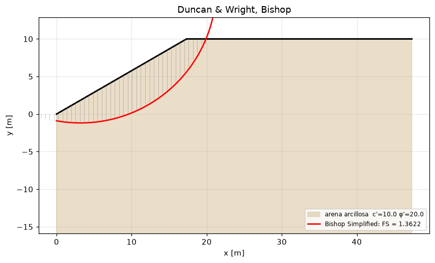

# slipcircle — stabilità dei pendii all'equilibrio limite (Fellenius, Bishop, Janbu, Spencer, Morgenstern-Price)

[Español](README.md) · [English](README.en.md) · [Português](README.pt.md) · **Italiano**

Coefficiente di sicurezza dei pendii con il metodo dei conci su superfici circolari e poligonali, ricerca del cerchio critico, pressione interstiziale (falda, linea piezometrica, r_u), analisi pseudostatica con i coefficienti della EN 1998-5, spostamento permanente con il blocco scorrevole di Newmark e con Bray-Travasarou (2007), rinforzo con geosintetici e chiodature, dreni orizzontali e coefficienti di sicurezza minimi per norma. Dipende da `numpy` e `scipy`; i metodi sono ancorati a forme chiuse e a esempi risolti del master.

[](https://github.com/jmurgass99/slipcircle/actions/workflows/ci.yml)
[](https://www.python.org/)
[](LICENSE)

## Quale problema risolve

Hai il profilo di un pendio, i suoi strati (c', φ', γ), forse una falda e un'azione sismica, e ti serve il coefficiente di sicurezza della superficie di scivolamento più sfavorevole con un metodo dei conci il cui risultato si possa verificare. Il pacchetto fornisce i cinque metodi classici sulla stessa discretizzazione, ti dice se il metodo rigoroso è andato a convergenza e ti permette il confronto con la forma chiusa quando esiste.

**Usalo quando**

- ti serve il FS di un pendio omogeneo o stratificato con Bishop o Fellenius e il cerchio critico per scansione;
- vuoi un confronto con un metodo rigoroso (Spencer, Morgenstern-Price) su un cerchio o una poligonale, con la garanzia che `converged` dice il vero;
- valuti il pendio con pressione interstiziale da falda, linea piezometrica o r_u, o con un sovraccarico in testa;
- esegui l'analisi pseudostatica della EN 1998-5 e stimi lo spostamento permanente (Newmark con accelerogramma, Ambraseys-Menu, Bray-Travasarou);
- aggiungi geogriglie, geotessili o chiodi e ti serve il loro momento resistente, o dimensioni dreni orizzontali in fase preliminare.

**Non usarlo per**

- analisi in tensioni efficaci con reticoli di filtrazione o consolidazione: la pressione interstiziale è un dato, non si calcola;
- rotture a cuneo in 3D, pendii in roccia (Hoek-Brown non c'è) o stabilità di dighe con filtrazione transitoria;
- una progettazione EC7 completa con coefficienti parziali: si confrontano valori caratteristici con minimi tabellati; i coefficienti su tan φ' e c' li applichi tu negli strati;
- la spinta sismica sui muri (K_AE di Mononobe-Okabe): `mononobe` è un cuneo pseudostatico di pendio indefinito, non un muro.

## Installazione

```bash
pip install git+https://github.com/jmurgass99/slipcircle.git
pip install "slipcircle[api,ui] @ git+https://github.com/jmurgass99/slipcircle.git"   # API REST e disegno con matplotlib
```

Per lo sviluppo: `git clone`, `pip install -e ".[test,api,ui]"`, `pytest -q` (24 file di test; include test di proprietà con hypothesis). Su Windows, se la console non è UTF-8, esegui gli esempi con `python -X utf8 examples/<nome>.py`.

## Funzionalità

| Funzionalità | Moduli | Norma o riferimento | Casi d'uso |
|---|---|---|---|
| Metodi dei conci su una superficie data: Fellenius, Bishop semplificato, Janbu semplificato e generalizzato, Spencer e Morgenstern-Price (f = seno, costante, trapezoidale); cerchi e poligonali | `fellenius`, `bishop`, `janbu`, `janbu_generalized`, `spencer`, `morgenstern_price`, `slices` | Fellenius 1936; Bishop 1955; Janbu 1973; Spencer 1967 (eq. 7 e 9); Morgenstern & Price 1965; Duncan & Wright | [6 casi](#1-metodi-dei-conci-su-una-superficie-data) |
| Cerchio critico, strati, acqua e sovraccarico: scansione di centri e raggi, falda orizzontale, linea piezometrica, r_u, rottura profonda, FS minimo per norma | `search`, `water`, `geometry`, `fs_by_code` | EN 1997-1 §11; USACE / FHWA; NSR-10 H.5; AS 4678 | [5 casi](#2-cerchio-critico-strati-acqua-e-sovraccarico) |
| Sisma: pseudostatico con k_h, k_v della EN 1998-5, blocco scorrevole di Newmark (impulso e accelerogramma), Ambraseys-Menu, Bray-Travasarou 2007, cuneo di pendio indefinito | `seismic`, `newmark`, `bray_travasarou`, `mononobe` | EN 1998-5 §4.1.3.3; Newmark 1965; Jibson 2007; Ambraseys & Menu 1988; Bray 2007 cap. 14 eq. 14.5; schede W00678/W00704 | [5 casi](#3-sisma-pseudostatico-newmark-e-bray-travasarou) |
| Rinforzo e drenaggio: geosintetici e chiodi come momento resistente nei quattro metodi, dreni orizzontali | `reinforcement`, `drains_casagrande` | scheda W00222 (Miglioramento dei terreni, UPC); Casagrande | [5 casi](#4-rinforzo-e-drenaggio) |
| Servizi tipizzati, API REST, collegamento con gli studi di fondazione e disegno | `services`, `api`, `integration.foundationcalc_bridge`, `visualization` | — | [4 casi](#5-servizi-api-integrazione-e-disegno) |

I 25 script di `examples/` sono stati eseguiti in un ambiente pulito prima della pubblicazione; il loro output è in `examples/output/` ed è quello riprodotto qui.

## Casi d'uso

Gli output sono riportati esattamente come li stampano gli script, in spagnolo.

### 1. Metodi dei conci su una superficie data

#### Pendio omogeneo di Duncan e Wright: cerchio critico e i quattro metodi

H = 10 m, β = 30°, c' = 10 kPa, φ' = 20°, γ = 18 kN/m³, asciutto. Ricerca con Bishop e confronto dei metodi sul cerchio critico. Con questa griglia il FS è 1,25; il riferimento pubblicato (1,3–1,4) corrisponde agli abachi e a cerchi che escono al piede; vedi il caso di raffinamento della griglia.

<details><summary>Output reale di <code>python examples/duncan_wright_homogeneous.py</code></summary>

```text
=== Critical surface search (Bishop) ===
  Critical FS = 1.3225
  Critical circle: cx=3.189  cy=20.182  R=19.818

=== Compare methods on the critical circle ===
  Bishop Simplified               FS = 1.3233
  Janbu Simplified                FS = 1.1451
  Spencer                         FS = 1.3205
  Morgenstern-Price               FS = 1.3136

=== Pseudo-static (kh = 0.10) ===
   {'method': 'Pseudo-static (Bishop modified)', 'FS': np.float64(1.0225), 'kh': 0.1, 'kv': 0.05, 'n_slices': 40, 'iterations': 8}
   Same circle, kh = 0.10, kv = 0.05: Bishop pseudo-static 1.022 (W_h at the slice base), Spencer 1.098, M-P 1.084 (W_h at the centroid); Bishop is 6.9% below Spencer
```

</details>

#### Argilla non drenata (φ = 0): Bishop, Fellenius e la forma chiusa del cerchio coincidono

FS = c·R·L_arco / Σ W·(x_m − c_x); ancoraggio analitico dei test golden.

<details><summary>Output reale di <code>python examples/undrained_clay_slope_phi_zero_closed_form_check.py</code></summary>

```text
Arco entre x = 2.74 y 35.80 m: L_arco = 38.028 m; Σ W·(x_m − c_x) = 20630.6 kN·m/m
Forma cerrada c·R·L_arco/Σ W·(x_m − c_x) = 1.1060
Bishop simplificado (200 dovelas)          = 1.1060
Fellenius (Σ c·l, l = b/cos α)             = 1.1060

En φ' = 0 los tres coinciden: cualquier diferencia sería un error en el tratamiento de mα o de la base de la dovela.
```

</details>

#### Pendio indefinito con rottura piana: FS = tan φ / tan β esatto, con poligonale e Fellenius

<details><summary>Output reale di <code>python examples/infinite_slope_planar_surface_fellenius_polyline.py</code></summary>

```text
β = 15.0°, φ' = 30.0°, γ = 20.0 kN/m³, z = 3.0 m

 c [kPa]  dovelas         FS  forma cerrada
       0        5   2.154701       2.154701
       0       40   2.154701       2.154701
       0      400   2.154701       2.154701
      10        5   2.821367       2.821367
      10       40   2.821367       2.821367
      10      400   2.821367       2.821367

Sin cohesión FS = tan φ / tan β: no depende de γ ni de z; con cohesión sí (término c/(γ·z·cos β·sin β)).
```

</details>

#### Superficie poligonale in un pendio stratificato: Janbu generalizzato, Janbu semplificato, Spencer e Morgenstern-Price

Tutti e quattro accettano la poligonale e quelli rigorosi indicano se sono andati a convergenza e con quale FS di forze e di momenti.

<details><summary>Output reale di <code>python examples/noncircular_polyline_surface_spencer_mp_janbu_generalized.py</code></summary>

```text
Superficie polilínea: [(0.0, 0.0), (6.0, -1.0), (14.0, 0.5), (22.0, 6.5), (28.0, 12.0)] 

Janbu generalizado:    FS = 1.3946  iteraciones = 32  convergió = True
Janbu simplificado:    FS = 1.3253  f₀ = 1.1
Spencer (polilínea):   FS = 1.5596  (fuerzas 1.5596, momentos 1.5596)  θ = 20.7°  convergió = True
M-P (polilínea):       FS = 1.5842  (fuerzas 1.5842, momentos 1.5842)  λ = 0.73  convergió = True

Janbu generalizado queda por debajo de Spencer y M-P (no impone la dirección de las fuerzas entre dovelas y usa la línea de empuje por defecto); Janbu simplificado con f₀ es la cota rápida.
```

</details>

#### Morgenstern-Price: effetto della funzione f(x) e coincidenza con Spencer per f costante

<details><summary>Output reale di <code>python examples/morgenstern_price_interslice_function_comparison.py</code></summary>

```text
método / f(x)                      FS    λ o θ  convergió
M-P, medio seno                1.3674   0.8002  True
M-P, constante                 1.3587   0.3510  True
M-P, trapezoidal               1.3638   0.6032  True
Spencer                        1.3587   19.342  True
```

</details>

#### Convergenza con il numero di conci e limite conservativo di Fellenius

<details><summary>Output reale di <code>python examples/slice_count_convergence_and_fellenius_bishop_ordering.py</code></summary>

```text
 dovelas  FS Bishop  iteraciones
      10     1.3525            7
      20     1.3611            7
      40     1.3622            7
      80     1.3632            7
     160     1.3633            7
     320     1.3633            7

Fellenius (160 dovelas) = 1.2578 ≤ Bishop = 1.3633: True (diferencia +8.4%)
```

</details>

### 2. Cerchio critico, strati, acqua e sovraccarico

#### Ricerca del cerchio critico: il FS rispetto alla finezza della griglia

Il FS minimo di Bishop rientra nell'intervallo pubblicato per questo pendio o resta di pochi decimi di punto sotto il suo limite inferiore; non scende in modo monotono raffinando, perché ogni griglia campiona centri e raggi diversi. Il confronto lo fa l'esempio stesso nella penultima riga.

<details><summary>Output reale di <code>python examples/critical_surface_search_grid_refinement_duncan_wright.py</code></summary>

```text
malla (cx, cy, R)  superficies  válidas   FS mín      cx      cy       R      s
(8, 8, 6)                  384        8   1.3078    3.19   17.14   17.40    0.0
(15, 12, 12)              2160       49   1.3225    3.19   20.18   19.82    0.2
(24, 18, 14)              6048      129   1.2976    2.48   20.47   20.61    0.7

Las cinco mejores superficies de la última malla:
  FS = 1.2976  centro (2.48, 20.47)  R = 20.62
  FS = 1.3209  centro (2.48, 19.41)  R = 19.15
  FS = 1.3239  centro (2.48, 23.65)  R = 23.54
  FS = 1.3321  centro (2.48, 17.29)  R = 17.69
  FS = 1.3331  centro (2.48, 22.59)  R = 22.08

FS mínimo entre mallas: 1.298 – 1.323; horquilla publicada 1,30 – 1,40 → 0.2% por debajo del límite inferior en la malla más desfavorable; el resto dentro
acceptable_EC7 (FS ≥ 1,5 con parámetros característicos): False
```

</details>

#### Pendio a due strati: falda e scansione pseudostatica

<details><summary>Output reale di <code>python examples/two_layer_slope_water_table_and_seismic_kh_sweep.py</code></summary>

```text
FS crítico en seco:            1.429
FS crítico con freático en y = 0 m: 1.356  (Δ = -5.1 %)

Barrido pseudo-estático sobre la superficie crítica húmeda (Bishop modificado):
    k_h      FS
   0.00   1.356
   0.05   1.216
   0.10   1.099
   0.15   0.998  ← inestable
   0.20   0.911  ← inestable
   0.25   0.836  ← inestable
```

</details>

#### Tre modelli di pressione interstiziale sulla stessa superficie

<details><summary>Output reale di <code>python examples/pore_pressure_models_horizontal_piezometric_ru.py</code></summary>

```text
Círculo crítico en seco: centro (4.091, 20.0), R = 20.778

seco                                           u_máx =    0.0 kPa  FS Fellenius = 1.5677
freático horizontal y_w = 0 m (pie)            u_máx =    7.6 kPa  FS Fellenius = 1.5222
línea piezométrica (0, 0) → (20, 6) → (40, 8)  u_máx =   28.6 kPa  FS Fellenius = 1.2414
r_u = 0,25 (u = r_u·γ·h por dovela)            u_máx =   25.1 kPa  FS Fellenius = 1.2088

Bishop con Slope.water_table_y = 0 m: FS = 1.6292 (seco: 1.6803)
```

</details>

#### Rilevato su argilla molle: rottura profonda attraverso la base e sovraccarico in testa

<details><summary>Output reale di <code>python examples/embankment_on_soft_clay_deep_failure_and_surcharge.py</code></summary>

```text
Estrato en (x = -3, y = -2), delante del pie: elevation → arcilla blanda; surface con [H, 20] → relleno granular
Solo círculos que salen por el pie:      FS = 1.239  centro (5.1, 9.2) R = 10.9  (48 válidos)
Círculos profundos permitidos (base):    FS = 1.077  centro (5.1, 9.2) R = 15.0  (865 válidos)
  cota mínima del círculo profundo: -5.84 m (la arcilla empieza en 0 m)
  referencia a mano (hundimiento de la base, φ = 0): N_c·c_u/(γ·H) = 5,14·20/(20·6) = 0.86 → el círculo profundo da 1.26 veces esa referencia

Sobre el círculo profundo: FS sin sobrecarga = 1.077, con 20 kPa en coronación = 0.928 (-13.9%)
```

</details>

#### FS minimo per norma e giudizio

<details><summary>Output reale di <code>python examples/fs_required_by_code_and_verdict.py</code></summary>

```text
FS estático (Bishop) = 1.362;  FS pseudo-estático (k_h = 0,10, k_v = 0,05) = 1.044

código escenario           FS mín  FS calc  veredicto
EU     static_persistent     1.00    1.362  cumple
EU     seismic               1.00    1.044  cumple
SG     static_persistent     1.00    1.362  cumple
US     static_persistent     1.50    1.362  NO cumple
US     seismic               1.10    1.044  NO cumple
CO     static_persistent     1.50    1.362  NO cumple
CO     seismic               1.05    1.044  NO cumple
AU     static_persistent     1.50    1.362  NO cumple
AU     seismic               1.10    1.044  NO cumple

Escenario no tabulado → ValueError: sin FS_min para ('EU', 'accidental')
```

</details>

### 3. Sisma: pseudostatico, Newmark e Bray-Travasarou

#### Pseudostatico secondo la EN 1998-5: k_h = α·S/(2·r) e stima di Ambraseys-Menu

<details><summary>Output reale di <code>python examples/pseudostatic_ec8_5_kh_from_ag_soil_factor_and_newmark_estimate.py</code></summary>

```text
a_g [g]    S    r    k_h    k_v      FS  Newmark (Ambraseys-Menu)
   0.10  1.0  1.0  0.050  0.025   1.187  D =   2.9 cm, admisible (< 30 cm): < 30 cm limit per EC8-5
   0.10  1.2  1.0  0.060  0.030   1.156  D =   2.9 cm, admisible (< 30 cm): < 30 cm limit per EC8-5
   0.10  1.2  1.5  0.040  0.020   1.219  D =   9.4 cm, admisible (< 30 cm): < 30 cm limit per EC8-5
   0.15  1.0  1.0  0.075  0.037   1.112  D =   2.9 cm, admisible (< 30 cm): < 30 cm limit per EC8-5
   0.15  1.2  1.0  0.090  0.045   1.070  D =   2.9 cm, admisible (< 30 cm): < 30 cm limit per EC8-5
   0.15  1.2  1.5  0.060  0.030   1.156  D =   9.4 cm, admisible (< 30 cm): < 30 cm limit per EC8-5
   0.25  1.0  1.0  0.125  0.062   0.982  D =   2.9 cm, admisible (< 30 cm): < 30 cm limit per EC8-5
   0.25  1.2  1.0  0.150  0.075   0.925  D =   2.9 cm, admisible (< 30 cm): < 30 cm limit per EC8-5
   0.25  1.2  1.5  0.100  0.050   1.044  D =   9.4 cm, admisible (< 30 cm): < 30 cm limit per EC8-5

Ambraseys-Menu usa k_y = k_h del análisis, no la aceleración de fluencia real del talud (FS = 1): es una estimación de cribado, no un cálculo de bloque deslizante.
```

</details>

#### Blocco scorrevole di Newmark con impulso rettangolare: soluzione in forma chiusa

D = ½·(A − k_y)·g·T²·(A/k_y) = 0,9197 m; lo spostamento non dipende dalla coda a riposo della registrazione.

<details><summary>Output reale di <code>python examples/newmark_sliding_block_rectangular_pulse_closed_form.py</code></summary>

```text
Forma cerrada con g = 9.81: D = 0.91969 m
Forma cerrada con g = 9.80665: D = 0.91937 m
cola de reposo 1 s: evaluate_newmark D = 0.91937 m (1 pulso, I_a = 1.926 m/s, high); newmark_integration D = 0.91601 m
cola de reposo 2 s: evaluate_newmark D = 0.91937 m (1 pulso, I_a = 1.926 m/s, high); newmark_integration D = 0.91601 m
cola de reposo 4 s: evaluate_newmark D = 0.91937 m (1 pulso, I_a = 1.926 m/s, high); newmark_integration D = 0.91601 m
```

</details>

#### Newmark con accelerogramma sintetico e scansione di k_y

<details><summary>Output reale di <code>python examples/newmark_displacement_from_synthetic_accelerogram_ky_sweep.py</code></summary>

```text
Registro: 2000 puntos, PGA = 0.350 g, Δt = 0.01 s

 k_y [g]   D [cm]  pulsos  I_a [m/s]  severidad
    0.05    38.87      55      2.855  high
    0.10    13.93      34      2.855  high
    0.15     5.29      19      2.855  medium
    0.20     2.00       9      2.855  medium
    0.25     0.74       3      2.855  low
    0.30     0.15       2      2.855  low

Solo cuentan los pulsos de signo ladera abajo que superan k_y; por encima de la PGA no hay deslizamiento.
```

</details>

#### Bray e Travasarou (2007): blocco rigido e caso Austrian Dam

<details><summary>Output reale di <code>python examples/bray_travasarou_2007_rigid_block_and_austrian_dam.py</code></summary>

```text
caso                              D mediano  P(D>5cm)  P(D>30cm)  referencia
bloque rígido (T_s = 0)              15.4 cm     0.956      0.156  15,4 cm
Austrian Dam, Loma Prieta 1989       34.2 cm     0.998      0.579  34,2 cm (observado 20–70 cm)
mismo talud con k_y = 0,25           12.4 cm     0.916      0.090  —

σ_lnD = 0.66; nivel de validación declarado por el módulo: experimental
```

</details>

#### Cuneo pseudostatico di pendio indefinito: ψ = atan(k_h/(1 ± k_v)) dalle schede W00678/W00704

<details><summary>Output reale di <code>python examples/pseudostatic_wedge_seismic_rotation_angle_w00678.py</code></summary>

```text
FS estático cerrado (talud indefinido) = 1.2566

  k_h    k_v  ψ [°] FS estático FS sísmico  seguro (FS ≥ 1,1)
 0.00  +0.00   0.00      1.2566     1.2566  True  
 0.20  -0.10  10.30      1.2566     0.8581  False  ficha «+k_v»: 10,3°
 0.20  +0.10  12.53      1.2566     0.8353  False  ficha «−k_v»: 12,5°
 0.10  +0.00   5.71      1.2566     1.0219  False  
 0.30  +0.00  16.70      1.2566     0.7129  False  
```

</details>

### 4. Rinforzo e drenaggio

#### Geotessile a metà altezza del pendio di Duncan e Wright nei quattro metodi

<details><summary>Output reale di <code>python examples/reinforced_slope.py</code></summary>

```text
=== FS comparison: unreinforced vs reinforced ===
  Bishop Simplified               FS_no_reinf=1.3622  FS_reinf=1.4590  dFS=+0.0968
  Janbu Simplified                FS_no_reinf=1.0992  FS_reinf=1.2227  dFS=+0.1235
  Spencer                         FS_no_reinf=1.3587  FS_reinf=1.4452  dFS=+0.0865
  Morgenstern-Price               FS_no_reinf=1.3674  FS_reinf=1.4539  dFS=+0.0865
```

</details>

#### Geotessile alla base di un rilevato su argilla: ΔFS con la forma chiusa (scheda W00222)

<details><summary>Output reale di <code>python examples/geotextile_at_embankment_base_bishop_moment_w00222.py</code></summary>

```text
Intersección geotextil-círculo en x = 5.408 m; fuerza de diseño T = 50.0 kN/m (gobierna T_adm)
Momento del refuerzo (reinforcement_moment) = 1100.0 kN·m/m
FS sin refuerzo = 1.1060
FS con geotextil = 1.1593  (M_refuerzo en el resultado: 1100.0)
ΔFS cerrado = T·(c_y − y)/Σ W·(x_m − c_x) = 0.0533; ΔFS calculado = 0.0533
```

</details>

#### File di chiodi in uno scavo: forza di progetto per sfilamento o per la barra

<details><summary>Output reale di <code>python examples/soil_nail_rows_on_cut_slope_bishop.py</code></summary>

```text
Bulón   cabeza (x, y)   intersección (x, y)   L tras rotura   T arrancamiento   T diseño
  ( 4.33,  2.5)   (11.16,  0.67)        2.93 m           73.6 kN       73.6 kN
  ( 8.66,  5.0)   (15.08,  3.28)        3.35 m           84.2 kN       84.2 kN
  (12.99,  7.5)   (17.78,  6.22)        5.04 m          126.7 kN      126.7 kN

FS sin bulones = 1.3622
FS con 1 fila(s) = 1.4640  (ΔFS = +0.1018)
FS con 2 fila(s) = 1.5492  (ΔFS = +0.1870)
FS con 3 fila(s) = 1.6318  (ΔFS = +0.2696)
```

</details>

#### Momento resistente di geogriglia e chiodi combinati nei quattro metodi

<details><summary>Output reale di <code>python examples/reinforcement_moment_breakdown_geogrid_and_nails_all_methods.py</code></summary>

```text
M_refuerzo geomalla               =    952.7 kN·m/m
M_refuerzo 2 bulones              =   1775.6 kN·m/m
M_refuerzo geomalla + 2 bulones   =   2728.3 kN·m/m

método                   FS sin   FS con     ΔFS
Bishop Simplified        1.3622   1.6365 +0.2743
Janbu Simplified         1.0992   1.4958 +0.3966
Spencer                  1.3587   1.6065 +0.2478
Morgenstern-Price        1.3674   1.6152 +0.2478
```

</details>

#### Dreni orizzontali: numero di dreni e tempo di abbassamento (progetto preliminare)

<details><summary>Output reale di <code>python examples/horizontal_drains_casagrande_design.py</code></summary>

```text
 k [m/s]  Q/dren [l/min]  n drenes  Q total [m³/día]  t descenso a 20 m
   1e-07           0.648         2             1.866          4629.6 días
   1e-06           6.480         2            18.662           463.0 días
   1e-05          64.800         2           186.624            46.3 días

Con drenes de 25 m: 1 drenes por tramo de 5 m, Q total 15.552 m³/día
```

</details>

### 5. Servizi, API, integrazione e disegno

#### Servizi tipizzati da specifiche piatte serializzabili

<details><summary>Output reale di <code>python examples/typed_services_bishop_spencer_search_seismic_from_flat_specs.py</code></summary>

```text
Bishop:   {'FS': 1.3622, 'n_slices': 40, 'iterations': 7, 'converged': True, 'M_d_kNm': 608.63, 'M_reinforcement_kNm': 0.0, 'method': 'Bishop Simplified'}
Spencer:  {'FS': 1.3587, 'theta_deg': 19.342, 'n_slices': 40, 'iterations': 30, 'residual_F': 0.0, 'residual_M': 0.0012, 'converged': True, 'method': 'Spencer'}
Búsqueda: {'critical_FS': 1.3605, 'cx': 5.422, 'cy': 16.0, 'R': 16.556, 'n_surfaces_tried': 1200, 'n_valid': 26, 'acceptable_EC7': False, 'method': 'Bishop Simplified (grid search)'}
Sísmico:  {'FS': 1.0436, 'kh': 0.1, 'kv': 0.05, 'n_slices': 30, 'iterations': 8, 'displacement_m': 0.0592, 'acceptable_EC8': True, 'method': 'Pseudo-static (Bishop modified)'}

Radio negativo → GeometryError: Radio debe ser > 0 (R=-1.0).
```

</details>

#### API REST senza server: Bishop, cerchio critico, pseudostatico, cuneo sismico e Newmark

<details><summary>Output reale di <code>python examples/rest_api_bishop_critical_slip_seismic_newmark_testclient.py</code></summary>

```text
GET /api/slope/health → {'status': 'ok', 'version': '1.3.1'}

POST /api/slope/bishop → 200
   {"FS": 1.3622, "n_slices": 40, "iterations": 7, "converged": true, "M_d_kNm": 608.63, "M_reinforcement_kNm": 0.0, "method": "Bishop Simplified"}

POST /api/slope/critical_slip → 200
   {"critical_FS": 1.3026, "cx": 1.369, "cy": 22.286, "R": 22.286, "n_surfaces_tried": 640, "n_valid": 11, "acceptable_EC7": false, "method": "Bishop Simplified (grid search)"}

POST /api/slope/seismic → 200
   {"FS": 1.0436, "kh": 0.1, "kv": 0.05, "n_slices": 30, "iterations": 8, "displacement_m": 0.0592, "acceptable_EC8": true, "method": "Pseudo-static (Bishop modified)"}

POST /api/slope/mononobe → 200
   {"FS_static": 1.256600119639834, "FS_seismic": 0.8580761521358327, "psi_deg": 10.304846468766033, "is_safe": false, "FS_min": 1.1, "code_reference": "Mononobe (1926) / Eurocode 8 Part 5"}

POST /api/slope/newmark (pulso 0,5 g × 0,5 s, k_y = 0,2) → 200 {"permanent_displacement_m": 0.9193734374999947, "permanent_displacement_cm": 91.93734374999947, "n_pulses_exceeding": 1, "arias_intensity_m_s": 1.9255312247703964, "severity": "high"}

Sin círculo → 422
```

</details>

#### Pendio costruito dagli strati di uno studio di fondazione

<details><summary>Output reale di <code>python examples/slope_from_foundation_study_layers_bridge.py</code></summary>

```text
  EST_1  c =   2.0 kPa  φ = 30.0°  γ = 19.0  base a  3.0 m
  EST_2  c =  30.0 kPa  φ =  0.0°  γ = 17.5  base a  8.0 m
  EST_3  c =   0.0 kPa  φ = 34.0°  γ = 20.0  base a 20.0 m

Talud 8 m (1V:1,5H) con freático en y = 0.0 m (cota del pie): FS crítico = 1.075, círculo (4.727, 11.2) R = 13.244, cota mínima -2.04 m

Capa de espesor 0 → GeotechError: Capa #1 con thickness <= 0 (0.0).
```

</details>

#### Disegno del pendio, del cerchio critico e dei conci in PNG

<details><summary>Output reale di <code>python examples/plot_critical_circle_and_slices_png.py</code></summary>

```text
Ignoring fixed y limits to fulfill fixed data aspect with adjustable data limits.
FS = 1.3622; figura guardada en examples\output\duncan_wright_critical_circle.png (30 kB)
```

</details>



## Verifica

- Forme chiuse: cerchio non drenato (φ = 0) per Bishop, Fellenius, Spencer e Morgenstern-Price; pendio indefinito asciutto e con coesione; impulso rettangolare di Newmark; ΔFS di un geotessile orizzontale con φ = 0; FS statico del cuneo di pendio indefinito.
- Schede del master UPC: Bishop su cerchi (W00254), stabilità globale EC7 (W01672), ψ = atan(k_h/(1 ± k_v)) = 10,3°/12,5° (W00678, W00704), geotessile come momento resistente (W00222). Bray-Travasarou ancorato all'equazione pubblicata (Bray 2007, eq. 14.5) e al caso Austrian Dam (34,2 cm).
- Coerenza tra metodi: Spencer e M-P entro il 2 % da Bishop nel pendio di Duncan e Wright e stabili tra 30 e 60 conci; M-P con f costante ≡ Spencer; una poligonale campionata dal cerchio riproduce il FS del cerchio (1 %) con Spencer e con M-P a f costante (con f a mezzo seno differisce di ≈ 1 %: test `xfail` documentato); Spencer con k_h = 0,10 sopra il Bishop pseudostatico ed entro il 10 %.
- Correzioni di questa revisione (1.3.0): Spencer e M-P usavano in Q_i il numeratore di Bishop (c·b, W − u·b) invece di quello di Spencer (c·l, W·cos α − u·l) e alternavano le radici con un intervallo che includeva i poli di Q_i, per cui il risultato dipendeva dal numero di conci e `converged` era sempre False; il momento globale del ramo poligonale sommava forze interne e mescolava i segni; l'azione sismica entrava con segno opposto in N/S. Il Janbu semplificato ora accetta poligonali.

## Limitazioni

- La ricerca del cerchio critico è una scansione a griglia di centri e raggi (Bishop per impostazione predefinita; `method=` accetta Spencer, Morgenstern-Price e Janbu) con un affinamento locale Nelder-Mead opzionale (`optimize_circle`); le superfici non circolari non entrano nella ricerca.
- `Slope.layer_at_depth` misura per impostazione predefinita la profondità dalla superficie locale (`layer_reference="surface"`): le interfacce sono parallele al profilo. Per strati orizzontali tagliati dal pendio (rilevato su terreno molle, scavo in strati orizzontali) usa `layer_reference="elevation"` con le profondità sotto y = 0. `slope_from_foundation_spec` crea il pendio con il valore predefinito.
- Le pressioni interstiziali sono dati (falda, piezometrica, r_u); non c'è reticolo di filtrazione. L'acqua esterna non è modellata: una falda sopra il terreno davanti al piede dà pressioni interstiziali senza il peso né le spinte della lama d'acqua e un FS artificialmente basso.
- `PseudoStaticAnalysis` (Bishop pseudostatico) applica W_h alla base del concio e usa W senza (1 − k_v) nel momento instabilizzante: è il più conservativo. Spencer e M-P con `kh` applicano W_h nel baricentro. I valori nel pendio di Duncan e Wright con k_h = 0,10 e k_v = 0,05 sono nell'ultima riga del suo caso d'uso.
- La stima dello spostamento di `PseudoStaticAnalysis.newmark_displacement` (Ambraseys-Menu) usa k_y = k_h dell'analisi, non l'accelerazione di snervamento del pendio; è da screening.
- `mononobe` è un cuneo di pendio indefinito con la gravità apparente ruotata di ψ, non il K_AE di un muro.
- Il rinforzo entra come momento resistente costante (trazione di progetto limitata dallo sfilamento o dall'elemento), senza interazione con la deformazione; con le poligonali lo applica solo il Janbu generalizzato.
- `drains_casagrande` e `fs_by_code` sono formule e tabelle da progetto preliminare.
- `bray_travasarou` è dichiarato `experimental`: equazione pubblicata riprodotta, senza una calibrazione propria.

## Norme e riferimenti

- EN 1997-1:2004 §11 (stabilità globale); EN 1998-5:2004 §4.1.3.3 (pseudostatico, k_h = α·S/(2·r), r = 1 o 1,5).
- Bishop, A. W. (1955), Géotechnique 5(1); Fellenius, W. (1936); Janbu, N. (1973); Spencer, E. (1967), Géotechnique 17(1), eq. 7 e 9; Morgenstern, N. R. e Price, V. E. (1965), Géotechnique 15(1).
- Duncan, J. M. e Wright, S. G., Soil Strength and Slope Stability, Wiley (cap. 6, metodi all'equilibrio limite e abachi).
- Newmark, N. M. (1965), Géotechnique 15(2); Jibson, R. W. (2007), Eng. Geology 91; Ambraseys, N. N. e Menu, J. M. (1988), EESD 16.
- Bray, J. D. (2007), Simplified seismic slope displacement procedures, in Earthquake Geotechnical Engineering, Springer, cap. 14, eq. 14.5 (= Bray & Travasarou 2007, JGGE 133(4)).
- NSR-10 Titolo H.5; USACE EM 1110-2-1902; AS 4678.
- Schede del Master in Ingegneria Strutturale e delle Costruzioni (UPC) citate per WorkID nelle docstring di `tests/`.

## Licenza

MIT. Vedi [LICENSE](LICENSE).

---

Parte di **Loadpath**, la raccolta di librerie strutturali open source di [Jesús Murgas](https://github.com/jmurgass99).
