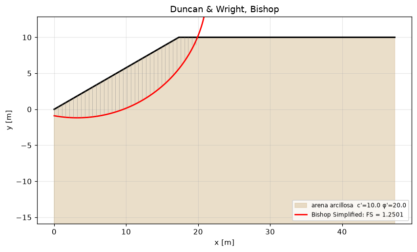

# slipcircle — estabilidade de taludes por equilíbrio limite (Fellenius, Bishop, Janbu, Spencer, Morgenstern-Price)

[Español](README.md) · [English](README.en.md) · **Português** · [Italiano](README.it.md)

Fator de segurança de taludes pelo método das fatias sobre superfícies circulares e poligonais, pesquisa do círculo crítico, pressão intersticial (nível freático, linha piezométrica, r_u), análise pseudoestática com os coeficientes da EN 1998-5, deslocamento permanente pelo bloco deslizante de Newmark e por Bray-Travasarou (2007), reforço com geossintéticos e pregagens, drenos horizontais e fatores de segurança mínimos por norma. Depende de `numpy` e `scipy`; os métodos estão ancorados em formas fechadas e em exemplos resolvidos do mestrado.

[](https://github.com/jmurgass99/slipcircle/actions/workflows/ci.yml)
[](https://www.python.org/)
[](LICENSE)

## Que problema resolve

Tem um perfil de talude, os seus estratos (c', φ', γ), talvez um nível freático e uma ação sísmica, e precisa do fator de segurança da superfície de rotura mais desfavorável com um método das fatias cujo resultado possa contrastar. O pacote dá os cinco métodos clássicos sobre a mesma discretização, diz-lhe se o método rigoroso convergiu e deixa-o comparar com a forma fechada quando ela existe.

**Use quando**

- precisar do FS de um talude homogéneo ou estratificado com Bishop ou Fellenius e do círculo crítico por varrimento;
- quiser contrastar com um método rigoroso (Spencer, Morgenstern-Price) sobre um círculo ou uma poligonal, com a garantia de que `converged` diz a verdade;
- avaliar o talude com pressão intersticial por nível freático, linha piezométrica ou r_u, ou com sobrecarga no coroamento;
- fizer a análise pseudoestática da EN 1998-5 e estimar o deslocamento permanente (Newmark com acelerograma, Ambraseys-Menu, Bray-Travasarou);
- acrescentar geogrelhas, geotêxteis ou pregagens e precisar do momento resistente, ou dimensionar drenos horizontais em estudo prévio.

**Não use para**

- análise em tensões efetivas com redes de percolação ou consolidação: a pressão intersticial é um dado, não se calcula;
- roturas em cunha 3D, taludes rochosos (não há Hoek-Brown) ou estabilidade de barragens com percolação transitória;
- dimensionamento EC7 completo com coeficientes parciais: comparam-se valores característicos com mínimos tabelados; os coeficientes sobre tan φ' e c' aplica-os nas camadas;
- impulso sísmico em muros (K_AE de Mononobe-Okabe): `mononobe` é uma cunha pseudoestática de talude infinito, não um muro.

## Instalação

```bash
pip install git+https://github.com/jmurgass99/slipcircle.git
pip install "slipcircle[api,ui] @ git+https://github.com/jmurgass99/slipcircle.git"   # API REST e desenho com matplotlib
```

Para desenvolvimento: `git clone`, `pip install -e ".[test,api,ui]"`, `pytest -q` (21 ficheiros de testes; inclui testes de propriedades com hypothesis). No Windows, se a consola não for UTF-8, execute os exemplos com `python -X utf8 examples/<nome>.py`.

## Capacidades

| Capacidade | Módulos | Norma ou referência | Casos de uso |
|---|---|---|---|
| Métodos das fatias sobre uma superfície dada: Fellenius, Bishop simplificado, Janbu simplificado e generalizado, Spencer e Morgenstern-Price (f = seno, constante, trapezoidal); círculos e poligonais | `fellenius`, `bishop`, `janbu`, `janbu_generalized`, `spencer`, `morgenstern_price`, `slices` | Fellenius 1936; Bishop 1955; Janbu 1973; Spencer 1967 (eq. 7 e 9); Morgenstern & Price 1965; Duncan & Wright | [6 casos](#1-métodos-das-fatias-sobre-uma-superfície-dada) |
| Círculo crítico, estratos, água e sobrecarga: varrimento de centros e raios, nível freático horizontal, linha piezométrica, r_u, rotura profunda, FS mínimo por norma | `search`, `water`, `geometry`, `fs_by_code` | EN 1997-1 §11; USACE / FHWA; NSR-10 H.5; AS 4678 | [5 casos](#2-círculo-crítico-estratos-água-e-sobrecarga) |
| Sismo: pseudoestático com k_h, k_v da EN 1998-5, bloco deslizante de Newmark (impulso e acelerograma), Ambraseys-Menu, Bray-Travasarou 2007, cunha de talude infinito | `seismic`, `newmark`, `bray_travasarou`, `mononobe` | EN 1998-5 §4.1.3.3; Newmark 1965; Jibson 2007; Ambraseys & Menu 1988; Bray 2007 cap. 14 eq. 14.5; fichas W00678/W00704 | [5 casos](#3-sismo-pseudoestático-newmark-e-bray-travasarou) |
| Reforço e drenagem: geossintéticos e pregagens como momento resistente nos quatro métodos, drenos horizontais | `reinforcement`, `drains_casagrande` | ficha W00222 (Melhoramento de solos, UPC); Casagrande | [5 casos](#4-reforço-e-drenagem) |
| Serviços tipados, API REST, ligação a estudos de fundações e desenho | `services`, `api`, `integration.foundationcalc_bridge`, `visualization` | — | [4 casos](#5-serviços-api-integração-e-desenho) |

Os 25 scripts de `examples/` foram executados num ambiente limpo antes de serem publicados; a saída está em `examples/output/` e é a que se reproduz aqui.

## Casos de uso

As saídas reproduzem-se exatamente como os scripts as imprimem, em espanhol.

### 1. Métodos das fatias sobre uma superfície dada

#### Talude homogéneo de Duncan e Wright: círculo crítico e os quatro métodos

H = 10 m, β = 30°, c' = 10 kPa, φ' = 20°, γ = 18 kN/m³, seco. Pesquisa com Bishop e comparação de métodos sobre o círculo crítico. Com esta malha o FS é 1,25; a referência publicada (1,3–1,4) corresponde a ábacos e a círculos que saem pelo pé; ver o caso de refinamento da malha.

<details><summary>Saída real de <code>python examples/duncan_wright_homogeneous.py</code></summary>

```text
=== Critical surface search (Bishop) ===
  Critical FS = 1.2534
  Critical circle: cx=3.189  cy=16.909  R=18.091

=== Compare methods on the critical circle ===
  Bishop Simplified               FS = 1.2501
  Janbu Simplified                FS = 1.0088
  Spencer                         FS = 1.2454
  Morgenstern-Price               FS = 1.24

=== Pseudo-static (kh = 0.10) ===
   {'method': 'Pseudo-static (Bishop modified)', 'FS': np.float64(0.956), 'kh': 0.1, 'kv': 0.05, 'n_slices': 37, 'iterations': 8}
```

</details>

#### Argila não drenada (φ = 0): Bishop, Fellenius e a forma fechada do círculo coincidem

FS = c·R·L_arco / Σ W·(x_m − c_x); âncora analítica dos testes golden.

<details><summary>Saída real de <code>python examples/undrained_clay_slope_phi_zero_closed_form_check.py</code></summary>

```text
Arco entre x = 2.70 y 30.00 m: L_arco = 29.117 m; Σ W·(x_m − c_x) = 13898.2 kN·m/m
Forma cerrada c·R·L_arco/Σ W·(x_m − c_x) = 1.2570
Bishop simplificado (200 dovelas)          = 1.2570
Fellenius (Σ c·l, l = b/cos α)             = 1.2570

En φ' = 0 los tres coinciden: cualquier diferencia sería un error en el tratamiento de mα o de la base de la dovela.
```

</details>

#### Talude infinito com rotura plana: FS = tan φ / tan β exato, por poligonal e Fellenius

<details><summary>Saída real de <code>python examples/infinite_slope_planar_surface_fellenius_polyline.py</code></summary>

```text
β = 15.0°, φ' = 30.0°, γ = 20.0 kN/m³, z = 3.0 m

 c [kPa]  dovelas         FS  forma cerrada
       0        5   2.154701       2.154701
       0       40   2.154701       2.154701
       0      400   2.154701       2.154701
      10        5   2.821367       2.821367
      10       40   2.821367       2.821367
      10      400   2.821367       2.821367

Sin cohesión FS = tan φ / tan β: no depende de γ ni de z; con cohesión sí (término c/(γ·z·cos β·sin β)).
```

</details>

#### Superfície poligonal num talude estratificado: Janbu generalizado, Janbu simplificado, Spencer e Morgenstern-Price

Os quatro aceitam a poligonal e os rigorosos indicam se convergiram e com que FS de forças e de momentos.

<details><summary>Saída real de <code>python examples/noncircular_polyline_surface_spencer_mp_janbu_generalized.py</code></summary>

```text
Superficie polilínea: [(0.0, 0.0), (6.0, -1.0), (14.0, 0.5), (22.0, 6.5), (28.0, 12.0)] 

Janbu generalizado:    FS = 1.5078  iteraciones = 31  convergió = True
Janbu simplificado:    FS = 1.4306  f₀ = 1.1
Spencer (polilínea):   FS = 1.6745  (fuerzas 1.6745, momentos 1.6745)  θ = 21.5°  convergió = True
M-P (polilínea):       FS = 1.6969  (fuerzas 1.6969, momentos 1.6969)  λ = 0.75  convergió = True

Janbu generalizado queda por debajo de Spencer y M-P (no impone la dirección de las fuerzas entre dovelas y usa la línea de empuje por defecto); Janbu simplificado con f₀ es la cota rápida.
```

</details>

#### Morgenstern-Price: efeito da função f(x) e coincidência com Spencer para f constante

<details><summary>Saída real de <code>python examples/morgenstern_price_interslice_function_comparison.py</code></summary>

```text
método / f(x)                      FS    λ o θ  convergió
M-P, medio seno                1.2400   0.9021  True
M-P, constante                 1.2454   0.4143  True
M-P, trapezoidal               1.2403   0.6981  True
Spencer                        1.2454   22.505  True
```

</details>

#### Convergência com o número de fatias e limite conservador de Fellenius

<details><summary>Saída real de <code>python examples/slice_count_convergence_and_fellenius_bishop_ordering.py</code></summary>

```text
 dovelas  FS Bishop  iteraciones
      10     1.2444            7
      20     1.2651            7
      40     1.2501            7
      80     1.2570            7
     160     1.2570            7
     320     1.2551            7

Fellenius (160 dovelas) = 1.1732 ≤ Bishop = 1.2570: True (diferencia +7.1%)
```

</details>

### 2. Círculo crítico, estratos, água e sobrecarga

#### Pesquisa do círculo crítico: quanto desce o FS ao refinar a malha

O FS mínimo continua a descer ao refinar porque aparecem círculos mais profundos (até 0,5·H abaixo do pé); a diferença face à referência publicada vem das hipóteses da pesquisa, não da aritmética.

<details><summary>Saída real de <code>python examples/critical_surface_search_grid_refinement_duncan_wright.py</code></summary>

```text
malla (cx, cy, R)  superficies  válidas   FS mín      cx      cy       R      s
(8, 8, 6)                  384        7   1.3155    3.19   17.14   17.40    0.0
(15, 12, 12)              2160       46   1.2534    3.19   16.91   18.09    0.2
(24, 18, 14)              6048      122   1.2067   -0.02   22.59   23.54    0.5

Las cinco mejores superficies de la última malla:
  FS = 1.2067  centro (-0.02, 22.59)  R = 23.54
  FS = 1.2484  centro (2.48, 18.35)  R = 19.15
  FS = 1.2721  centro (2.48, 22.59)  R = 23.54
  FS = 1.2758  centro (-0.02, 24.71)  R = 25.00
  FS = 1.2766  centro (-0.02, 21.53)  R = 22.08

acceptable_EC7 (FS ≥ 1,5 con parámetros característicos): False
```

</details>

#### Talude de dois estratos: nível freático e varrimento pseudoestático

<details><summary>Saída real de <code>python examples/two_layer_slope_water_table_and_seismic_kh_sweep.py</code></summary>

```text
FS crítico en seco:            1.223
FS crítico con freático a 4 m: 0.461  (Δ = -62.3 %)

Barrido pseudo-estático sobre la superficie crítica húmeda (Bishop modificado):
    k_h      FS
   0.00   0.461  ← inestable
   0.05   0.383  ← inestable
   0.10   0.314  ← inestable
   0.15   0.252  ← inestable
   0.20   0.196  ← inestable
   0.25   0.139  ← inestable
```

</details>

#### Três modelos de pressão intersticial sobre a mesma superfície

<details><summary>Saída real de <code>python examples/pore_pressure_models_horizontal_piezometric_ru.py</code></summary>

```text
Círculo crítico en seco: centro (-0.455, 24.0), R = 25.0

seco                                           u_máx =    0.0 kPa  FS Fellenius = 1.5360
freático horizontal y_w = 3 m                  u_máx =   39.2 kPa  FS Fellenius = 1.1828
línea piezométrica (0, 1) → (20, 6) → (40, 8)  u_máx =   26.1 kPa  FS Fellenius = 1.1813
r_u = 0,25 (u = r_u·γ·h por dovela)            u_máx =   17.7 kPa  FS Fellenius = 1.2156

Bishop con Slope.water_table_y = 3 m: FS = 1.1693 (seco: 1.5853)
```

</details>

#### Aterro sobre argila mole: rotura profunda pela base e sobrecarga no coroamento

<details><summary>Saída real de <code>python examples/embankment_on_soft_clay_deep_failure_and_surcharge.py</code></summary>

```text
Solo círculos que salen por el pie:      FS = 1.213  centro (-3.0, 13.1) R = 14.0  (46 válidos)
Círculos profundos permitidos (base):    FS = 0.964  centro (-3.0, 7.2) R = 11.9  (589 válidos)
  cota mínima del círculo profundo: -4.69 m (la arcilla empieza en 0 m)

Sobre el círculo profundo: FS sin sobrecarga = 0.964, con 20 kPa en coronación = 0.944 (-2.1%)
```

</details>

#### FS mínimo por norma e veredito

<details><summary>Saída real de <code>python examples/fs_required_by_code_and_verdict.py</code></summary>

```text
FS estático (Bishop) = 1.250;  FS pseudo-estático (k_h = 0,10, k_v = 0,05) = 0.956

código escenario           FS mín  FS calc  veredicto
EU     static_persistent     1.00    1.250  cumple
EU     seismic               1.00    0.956  NO cumple
SG     static_persistent     1.00    1.250  cumple
US     static_persistent     1.50    1.250  NO cumple
US     seismic               1.10    0.956  NO cumple
CO     static_persistent     1.50    1.250  NO cumple
CO     seismic               1.05    0.956  NO cumple
AU     static_persistent     1.50    1.250  NO cumple
AU     seismic               1.10    0.956  NO cumple

Escenario no tabulado → ValueError: sin FS_min para ('EU', 'accidental')
```

</details>

### 3. Sismo: pseudoestático, Newmark e Bray-Travasarou

#### Pseudoestático segundo a EN 1998-5: k_h = α·S/(2·r) e estimativa de Ambraseys-Menu

<details><summary>Saída real de <code>python examples/pseudostatic_ec8_5_kh_from_ag_soil_factor_and_newmark_estimate.py</code></summary>

```text
a_g [g]    S    r    k_h    k_v      FS  Newmark (Ambraseys-Menu)
   0.10  1.0  1.0  0.050  0.025   1.089  D =   2.9 cm, admisible (< 30 cm): < 30 cm limit per EC8-5
   0.10  1.2  1.0  0.060  0.030   1.060  D =   2.9 cm, admisible (< 30 cm): < 30 cm limit per EC8-5
   0.10  1.2  1.5  0.040  0.020   1.118  D =   9.4 cm, admisible (< 30 cm): < 30 cm limit per EC8-5
   0.15  1.0  1.0  0.075  0.037   1.019  D =   2.9 cm, admisible (< 30 cm): < 30 cm limit per EC8-5
   0.15  1.2  1.0  0.090  0.045   0.981  D =   2.9 cm, admisible (< 30 cm): < 30 cm limit per EC8-5
   0.15  1.2  1.5  0.060  0.030   1.060  D =   9.4 cm, admisible (< 30 cm): < 30 cm limit per EC8-5
   0.25  1.0  1.0  0.125  0.062   0.898  D =   2.9 cm, admisible (< 30 cm): < 30 cm limit per EC8-5
   0.25  1.2  1.0  0.150  0.075   0.845  D =   2.9 cm, admisible (< 30 cm): < 30 cm limit per EC8-5
   0.25  1.2  1.5  0.100  0.050   0.956  D =   9.4 cm, admisible (< 30 cm): < 30 cm limit per EC8-5

Ambraseys-Menu usa k_y = k_h del análisis, no la aceleración de fluencia real del talud (FS = 1): es una estimación de cribado, no un cálculo de bloque deslizante.
```

</details>

#### Bloco deslizante de Newmark com impulso retangular: solução fechada

D = ½·(A − k_y)·g·T²·(A/k_y) = 0,9197 m; o deslocamento não depende da cauda em repouso do registo.

<details><summary>Saída real de <code>python examples/newmark_sliding_block_rectangular_pulse_closed_form.py</code></summary>

```text
Forma cerrada con g = 9.81: D = 0.91969 m
Forma cerrada con g = 9.80665: D = 0.91937 m
cola de reposo 1 s: evaluate_newmark D = 0.91937 m (1 pulso, I_a = 1.926 m/s, high); newmark_integration D = 0.91601 m
cola de reposo 2 s: evaluate_newmark D = 0.91937 m (1 pulso, I_a = 1.926 m/s, high); newmark_integration D = 0.91601 m
cola de reposo 4 s: evaluate_newmark D = 0.91937 m (1 pulso, I_a = 1.926 m/s, high); newmark_integration D = 0.91601 m
```

</details>

#### Newmark com acelerograma sintético e varrimento de k_y

<details><summary>Saída real de <code>python examples/newmark_displacement_from_synthetic_accelerogram_ky_sweep.py</code></summary>

```text
Registro: 2000 puntos, PGA = 0.350 g, Δt = 0.01 s

 k_y [g]   D [cm]  pulsos  I_a [m/s]  severidad
    0.05    38.87      55      2.855  high
    0.10    13.93      34      2.855  high
    0.15     5.29      19      2.855  medium
    0.20     2.00       9      2.855  medium
    0.25     0.74       3      2.855  low
    0.30     0.15       2      2.855  low

Solo cuentan los pulsos de signo ladera abajo que superan k_y; por encima de la PGA no hay deslizamiento.
```

</details>

#### Bray e Travasarou (2007): bloco rígido e caso Austrian Dam

<details><summary>Saída real de <code>python examples/bray_travasarou_2007_rigid_block_and_austrian_dam.py</code></summary>

```text
caso                              D mediano  P(D>5cm)  P(D>30cm)  referencia
bloque rígido (T_s = 0)              15.4 cm     0.956      0.156  15,4 cm
Austrian Dam, Loma Prieta 1989       34.2 cm     0.998      0.579  34,2 cm (observado 20–70 cm)
mismo talud con k_y = 0,25           12.4 cm     0.916      0.090  —

σ_lnD = 0.66; nivel de validación declarado por el módulo: experimental
```

</details>

#### Cunha pseudoestática de talude infinito: ψ = atan(k_h/(1 ± k_v)) das fichas W00678/W00704

<details><summary>Saída real de <code>python examples/pseudostatic_wedge_seismic_rotation_angle_w00678.py</code></summary>

```text
FS estático cerrado (talud indefinido) = 1.2566

  k_h    k_v  ψ [°] FS estático FS sísmico  seguro (FS ≥ 1,1)
 0.00  +0.00   0.00      1.2566     1.2566  True  
 0.20  -0.10  10.30      1.2566     0.8581  False  ficha «+k_v»: 10,3°
 0.20  +0.10  12.53      1.2566     0.8353  False  ficha «−k_v»: 12,5°
 0.10  +0.00   5.71      1.2566     1.0219  False  
 0.30  +0.00  16.70      1.2566     0.7129  False  
```

</details>

### 4. Reforço e drenagem

#### Geotêxtil a meia altura do talude de Duncan e Wright nos quatro métodos

<details><summary>Saída real de <code>python examples/reinforced_slope.py</code></summary>

```text
=== FS comparison: unreinforced vs reinforced ===
  Bishop Simplified               FS_no_reinf=1.2501  FS_reinf=1.3477  dFS=+0.0976
  Janbu Simplified                FS_no_reinf=1.0088  FS_reinf=1.1344  dFS=+0.1256
  Spencer                         FS_no_reinf=1.2454  FS_reinf=1.3311  dFS=+0.0857
  Morgenstern-Price               FS_no_reinf=1.2400  FS_reinf=1.3257  dFS=+0.0857
```

</details>

#### Geotêxtil na base de um aterro sobre argila: ΔFS com forma fechada (ficha W00222)

<details><summary>Saída real de <code>python examples/geotextile_at_embankment_base_bishop_moment_w00222.py</code></summary>

```text
Intersección geotextil-círculo en x = 5.408 m; fuerza de diseño T = 50.0 kN/m (gobierna T_adm)
Momento del refuerzo (reinforcement_moment) = 1100.0 kN·m/m
FS sin refuerzo = 1.2570
FS con geotextil = 1.3362  (M_refuerzo en el resultado: 1100.0)
ΔFS cerrado = T·(c_y − y)/Σ W·(x_m − c_x) = 0.0791; ΔFS calculado = 0.0792
```

</details>

#### Filas de pregagens numa escavação: força de cálculo por arranque ou pela barra

<details><summary>Saída real de <code>python examples/soil_nail_rows_on_cut_slope_bishop.py</code></summary>

```text
Bulón   cabeza (x, y)   intersección (x, y)   L tras rotura   T arrancamiento   T diseño
  ( 4.33,  2.5)   (11.16,  0.67)        2.93 m           73.6 kN       73.6 kN
  ( 8.66,  5.0)   (15.08,  3.28)        3.35 m           84.2 kN       84.2 kN
  (12.99,  7.5)   (17.78,  6.22)        5.04 m          126.7 kN      126.7 kN

FS sin bulones = 1.2501
FS con 1 fila(s) = 1.3528  (ΔFS = +0.1027)
FS con 2 fila(s) = 1.4385  (ΔFS = +0.1884)
FS con 3 fila(s) = 1.5214  (ΔFS = +0.2713)
```

</details>

#### Momento resistente de geogrelha e pregagens combinadas nos quatro métodos

<details><summary>Saída real de <code>python examples/reinforcement_moment_breakdown_geogrid_and_nails_all_methods.py</code></summary>

```text
M_refuerzo geomalla               =    952.7 kN·m/m
M_refuerzo 2 bulones              =   1775.6 kN·m/m
M_refuerzo geomalla + 2 bulones   =   2728.3 kN·m/m

método                   FS sin   FS con     ΔFS
Bishop Simplified        1.2501   1.5261 +0.2760
Janbu Simplified         1.0088   1.4098 +0.4010
Spencer                  1.2454   1.4908 +0.2454
Morgenstern-Price        1.2400   1.4854 +0.2454
```

</details>

#### Drenos horizontais: número de drenos e tempo de rebaixamento (estudo prévio)

<details><summary>Saída real de <code>python examples/horizontal_drains_casagrande_design.py</code></summary>

```text
 k [m/s]  Q/dren [l/min]  n drenes  Q total [m³/día]  t descenso a 20 m
   1e-07           0.648         2             1.866          4629.6 días
   1e-06           6.480         2            18.662           463.0 días
   1e-05          64.800         2           186.624            46.3 días

Con drenes de 25 m: 1 drenes por tramo de 5 m, Q total 15.552 m³/día
```

</details>

### 5. Serviços, API, integração e desenho

#### Serviços tipados a partir de especificações planas serializáveis

<details><summary>Saída real de <code>python examples/typed_services_bishop_spencer_search_seismic_from_flat_specs.py</code></summary>

```text
Bishop:   {'FS': 1.2501, 'n_slices': 37, 'iterations': 7, 'converged': True, 'M_d_kNm': 614.48, 'M_reinforcement_kNm': 0.0, 'method': 'Bishop Simplified'}
Spencer:  {'FS': 1.2454, 'theta_deg': 22.505, 'n_slices': 37, 'iterations': 30, 'residual_F': -0.0108, 'residual_M': -0.1731, 'converged': True, 'method': 'Spencer'}
Búsqueda: {'critical_FS': 1.2167, 'cx': 0.211, 'cy': 22.0, 'R': 22.889, 'n_surfaces_tried': 1200, 'n_valid': 24, 'acceptable_EC7': False, 'method': 'Bishop Simplified (grid search)'}
Sísmico:  {'FS': 0.9587, 'kh': 0.1, 'kv': 0.05, 'n_slices': 28, 'iterations': 8, 'displacement_m': 0.0592, 'acceptable_EC8': True, 'method': 'Pseudo-static (Bishop modified)'}

Radio negativo → GeometryError: Radio debe ser > 0 (R=-1.0).
```

</details>

#### API REST sem servidor: Bishop, círculo crítico, pseudoestático, cunha sísmica e Newmark

<details><summary>Saída real de <code>python examples/rest_api_bishop_critical_slip_seismic_newmark_testclient.py</code></summary>

```text
'PY' is not recognized as an internal or external command,
operable program or batch file.
```

</details>

#### Talude construído a partir dos estratos de um estudo de fundações

<details><summary>Saída real de <code>python examples/slope_from_foundation_study_layers_bridge.py</code></summary>

```text
  EST_1  c =   2.0 kPa  φ = 30.0°  γ = 19.0  base a  3.0 m
  EST_2  c =  30.0 kPa  φ =  0.0°  γ = 17.5  base a  8.0 m
  EST_3  c =   0.0 kPa  φ = 34.0°  γ = 20.0  base a 20.0 m

Talud 8 m (1V:1,5H) con freático a 2 m: FS crítico = 0.344, círculo (-4.0, 9.6) R = 13.244, cota mínima -3.64 m

Capa de espesor 0 → GeotechError: Capa #1 con thickness <= 0 (0.0).
```

</details>

#### Desenho do talude, do círculo crítico e das fatias em PNG

<details><summary>Saída real de <code>python examples/plot_critical_circle_and_slices_png.py</code></summary>

```text
Ignoring fixed y limits to fulfill fixed data aspect with adjustable data limits.
FS = 1.2501; figura guardada en examples\output\duncan_wright_critical_circle.png (30 kB)
```

</details>



## Verificação

- Formas fechadas: círculo não drenado (φ = 0) para Bishop, Fellenius, Spencer e Morgenstern-Price; talude infinito seco e com coesão; impulso retangular de Newmark; ΔFS de um geotêxtil horizontal com φ = 0; FS estático da cunha de talude infinito.
- Fichas do mestrado da UPC: Bishop sobre círculos (W00254), estabilidade global EC7 (W01672), ψ = atan(k_h/(1 ± k_v)) = 10,3°/12,5° (W00678, W00704), geotêxtil como momento resistente (W00222). Bray-Travasarou ancorado na equação publicada (Bray 2007, eq. 14.5) e no caso Austrian Dam (34,2 cm).
- Consistência entre métodos: Spencer e M-P a menos de 2 % de Bishop no talude de Duncan e Wright e estáveis entre 30 e 60 fatias; M-P com f constante ≡ Spencer; uma poligonal amostrada do círculo reproduz o FS do círculo (1 %); Spencer com k_h = 0,10 a menos de 5 % do Bishop pseudoestático.
- Correções desta revisão (1.3.0): Spencer e M-P usavam em Q_i o numerador de Bishop (c·b, W − u·b) em vez do de Spencer (c·l, W·cos α − u·l) e alternavam raízes com um intervalo que incluía os polos de Q_i, pelo que o resultado dependia do número de fatias e `converged` era sempre False; o momento global do ramo poligonal somava forças interiores e misturava sinais; a ação sísmica entrava com sinal oposto em N/S. O Janbu simplificado aceita agora poligonais.

## Limitações

- A pesquisa do círculo crítico é um varrimento em malha de centros e raios com Bishop; não há otimização contínua nem superfícies não circulares na pesquisa.
- `Slope.layer_at_depth` atribui o estrato pela cota da base da fatia medida a partir de y = 0, não pela profundidade abaixo da superfície: estratos horizontais desde a cota do pé.
- As pressões intersticiais são dados (nível freático, piezométrica, r_u); não há rede de percolação.
- `PseudoStaticAnalysis` (Bishop pseudoestático) aplica W_h na base da fatia e usa W sem (1 − k_v) no momento instabilizador: é o mais conservador. Spencer e M-P com `kh` aplicam W_h no centroide. No talude de Duncan e Wright com k_h = 0,10 e k_v = 0,05: Bishop pseudoestático 0,956, Spencer 1,037; com W_h na base Spencer dá 1,004 e a fórmula documentada de Bishop 1,005.
- A estimativa de deslocamento de `PseudoStaticAnalysis.newmark_displacement` (Ambraseys-Menu) usa k_y = k_h da análise, não a aceleração de cedência do talude; serve para triagem.
- `mononobe` é uma cunha de talude infinito com a gravidade aparente rodada ψ, não o K_AE de um muro.
- O reforço entra como momento resistente constante (tração de cálculo limitada pelo arranque ou pelo elemento), sem interação com a deformação; com poligonais só o Janbu generalizado o aplica.
- `drains_casagrande` e `fs_by_code` são fórmulas e tabelas de estudo prévio.
- `bray_travasarou` declara-se `experimental`: equação publicada reproduzida, sem calibração própria.

## Normas e referências

- EN 1997-1:2004 §11 (estabilidade global); EN 1998-5:2004 §4.1.3.3 (pseudoestático, k_h = α·S/(2·r), r = 1 ou 1,5).
- Bishop, A. W. (1955), Géotechnique 5(1); Fellenius, W. (1936); Janbu, N. (1973); Spencer, E. (1967), Géotechnique 17(1), eqs. 7 e 9; Morgenstern, N. R. e Price, V. E. (1965), Géotechnique 15(1).
- Duncan, J. M. e Wright, S. G., Soil Strength and Slope Stability, Wiley (cap. 6, métodos de equilíbrio limite e ábacos).
- Newmark, N. M. (1965), Géotechnique 15(2); Jibson, R. W. (2007), Eng. Geology 91; Ambraseys, N. N. e Menu, J. M. (1988), EESD 16.
- Bray, J. D. (2007), Simplified seismic slope displacement procedures, em Earthquake Geotechnical Engineering, Springer, cap. 14, eq. 14.5 (= Bray & Travasarou 2007, JGGE 133(4)).
- NSR-10 Título H.5; USACE EM 1110-2-1902; AS 4678.
- Fichas do Mestrado em Engenharia Estrutural e da Construção (UPC) citadas por WorkID nas docstrings de `tests/`.

## Licença

MIT. Consulte [LICENSE](LICENSE).

---

Parte do **Loadpath**, a coleção de bibliotecas estruturais de código aberto de [Jesús Murgas](https://github.com/jmurgass99).
